

  <h2>Academic Service</h2>

  

    

      <h3>Associate Editor</h3>
      <ul>
        <li><em>Pattern Recognition</em></li>
      </ul>
    

    

      <h3>Area Chair</h3>
      <ul>
        <li>IEEE/CVF Conference on Computer Vision and Pattern Recognition (CVPR)</li>
        <li>ACM International Conference on Multimedia (ACM MM)</li>
        <li>IEEE/CVF Winter Conference on Applications of Computer Vision (WACV)</li>
        <li>AAAI Conference on Artificial Intelligence (AAAI)</li>
      </ul>
    

    

      <h3>Senior Program Committee Member / Program Committee Member</h3>
      <ul>
        <li>IEEE/CVF Conference on Computer Vision and Pattern Recognition (CVPR)</li>
        <li>IEEE/CVF International Conference on Computer Vision (ICCV)</li>
        <li>Conference on Neural Information Processing Systems (NeurIPS)</li>
        <li>AAAI Conference on Artificial Intelligence (AAAI)</li>
        <li>ACM International Conference on Multimedia (ACM MM)</li>
      </ul>
    

    

      <h3>Reviewer for International Journals</h3>
      <ul>
        <li>IEEE Transactions on Pattern Analysis and Machine Intelligence (TPAMI)</li>
        <li>International Journal of Computer Vision (IJCV)</li>
        <li>IEEE Transactions on Image Processing (TIP)</li>
        <li>IEEE Transactions on Neural Networks and Learning Systems (TNNLS)</li>
      </ul>
    

  

<h2>Research Interests</h2>

  <!-- ==================================================
       01. Multimodal Understanding and Cognition
       ================================================== -->
  

    

      01

      

        <h3>Multimodal Understanding and Cognition</h3>
        

          Research on multimodal representation learning, multimodal reasoning,
          and cross-modal understanding.
        

      

    

    

      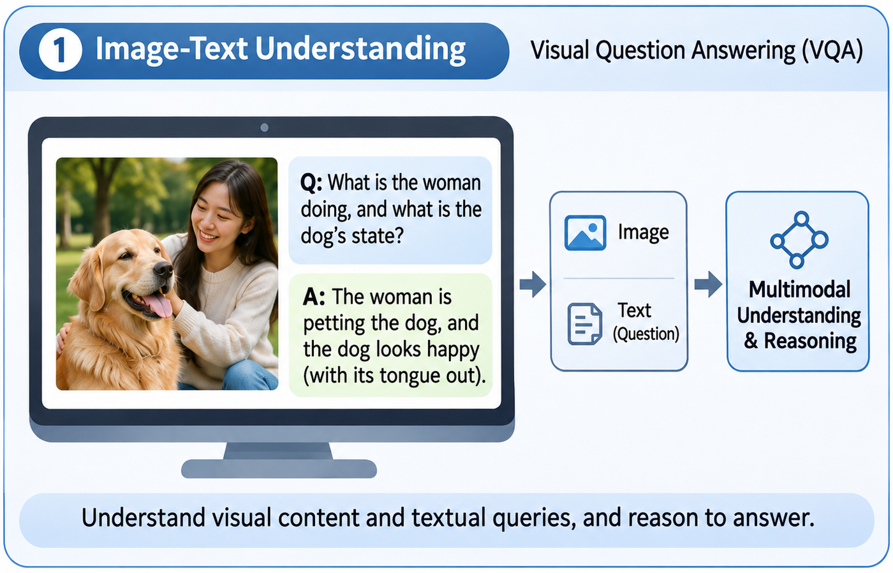

      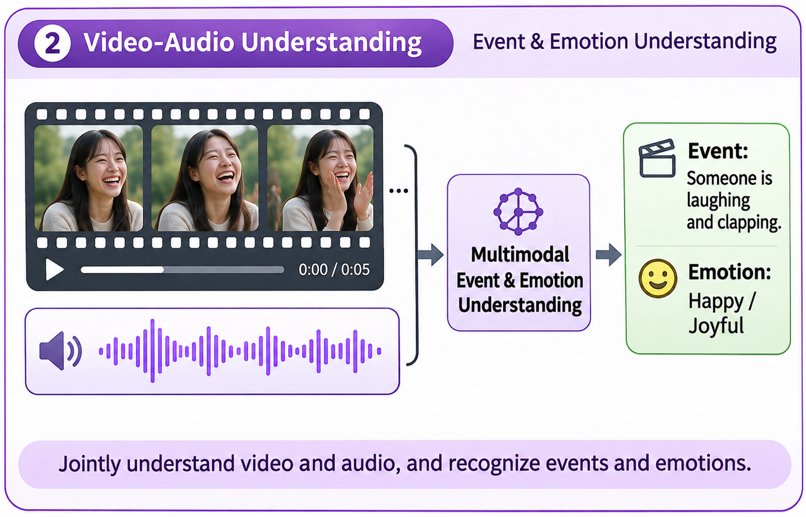

      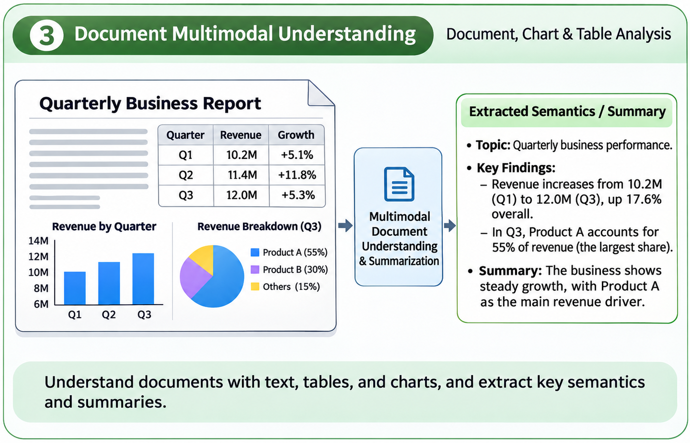

      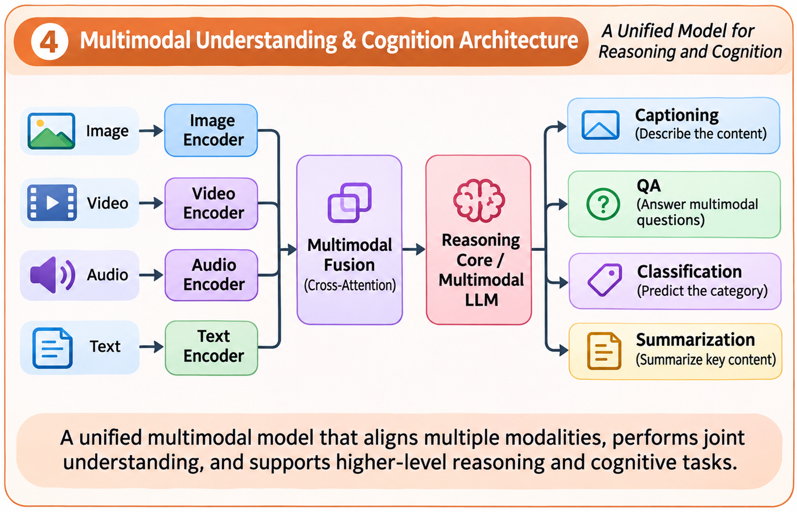

    

  

  <!-- ==================================================
       02. Multimodal Embodied Intelligence
       ================================================== -->
  

    

      02

      

        <h3>Multimodal Embodied Intelligence</h3>
        

          Research on embodied perception, action, decision-making,
          and vision-language-action models.
        

      

    

    

      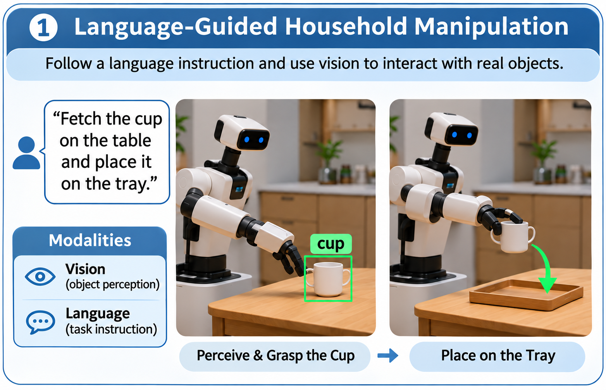

      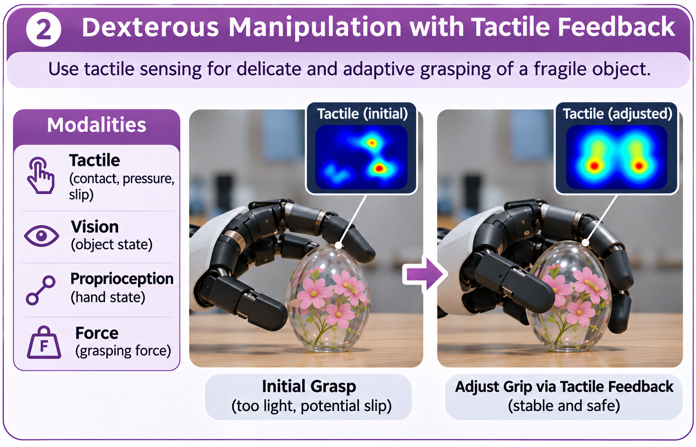

      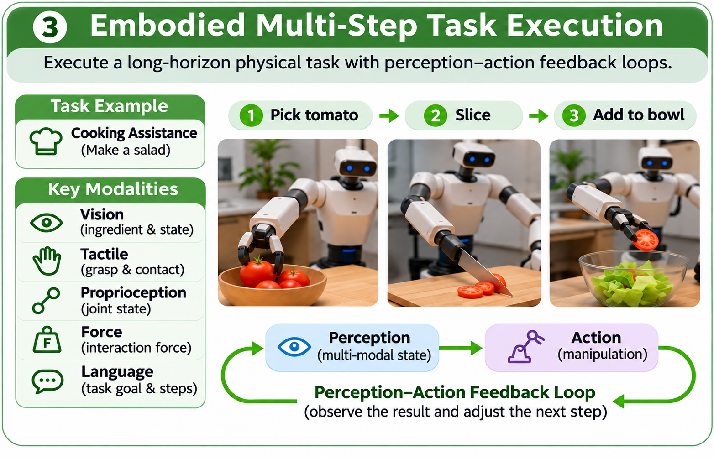

      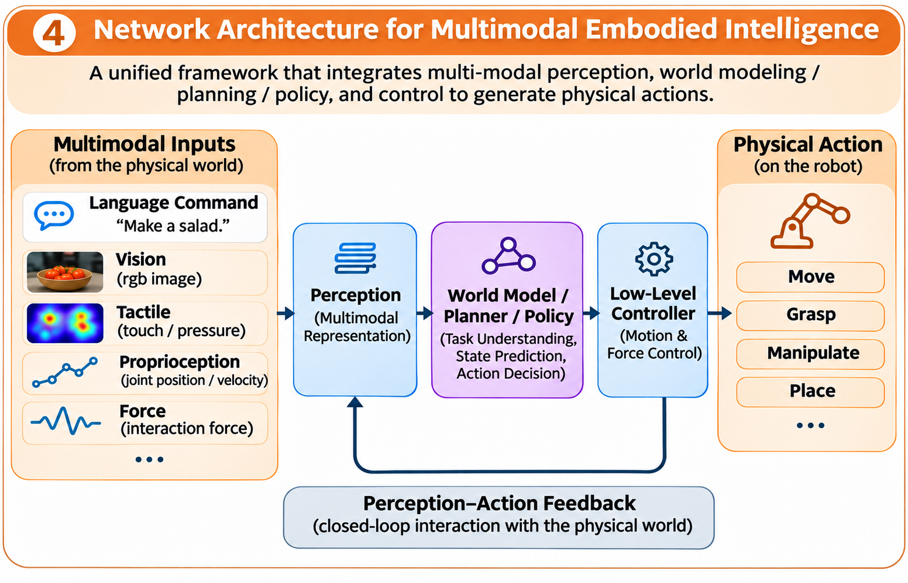

    

  

  <!-- ==================================================
       03. Spatial Intelligence
       ================================================== -->
  

    

      03

      

        <h3>Spatial Intelligence</h3>
        

          Research on 3D scene understanding, spatial reasoning,
          and intelligent perception in complex environments.
        

      

    

    

      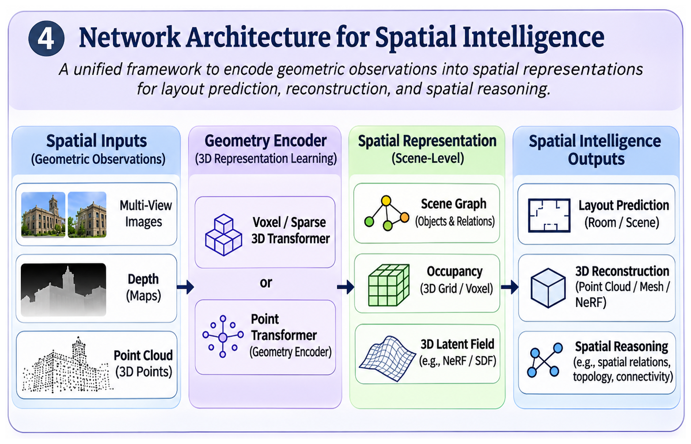

      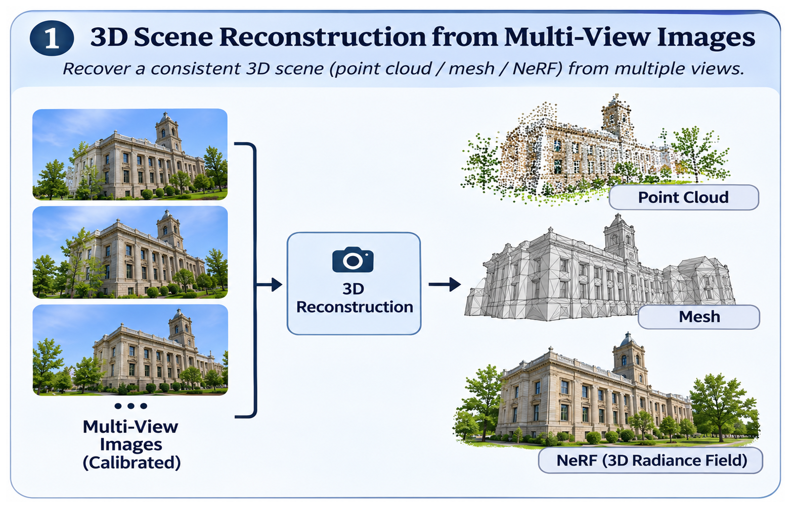

      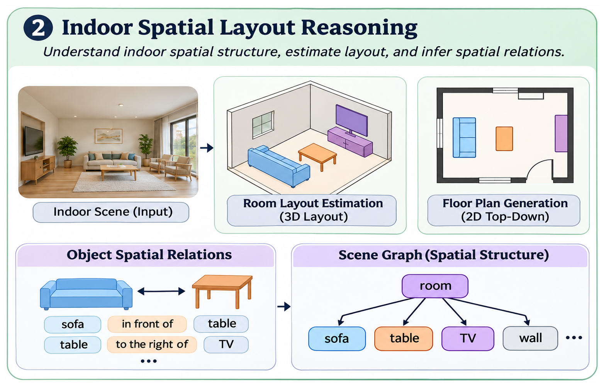

      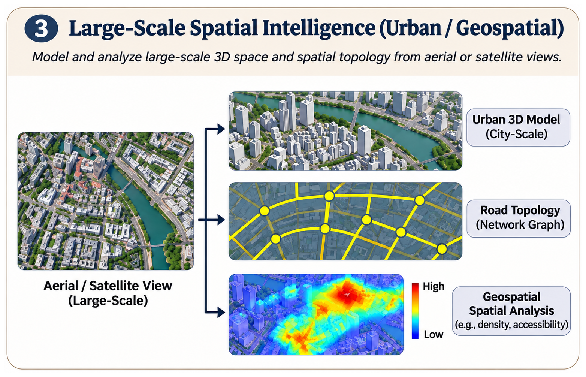

    

  

